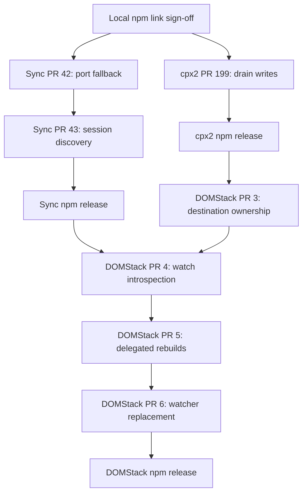

# Multiple watch builds — implementation plan

Issue: [bcomnes/domstack#352](https://github.com/bcomnes/domstack/issues/352)

## Phase 1 — Implement and verify end to end locally

Finish the full feature set in the local stack with `npm link` builds of `cpx2` and `@domstack/sync`.
Keep the published dependency ranges unchanged and the existing upstream PRs open; do not open the DOMStack PRs, merge branches, or publish packages during this phase.
The release sequence is at the [bottom of this plan](#phase-2--open-merge-and-publish-after-local-sign-off).

### Progress

| Step | Repository | PR | Status |
| --- | --- | --- | --- |
| [1. Race-free port fallback](#pr-1--sync-race-free-port-fallback) | `domstack-sync` | [#42](https://github.com/bcomnes/domstack-sync/pull/42) | Open for review |
| [2. Local session discovery](#pr-2--sync-local-session-discovery) | `domstack-sync` | [#43](https://github.com/bcomnes/domstack-sync/pull/43) | Open for review; stacked on #42 |
| [3a. Copy lifecycle prerequisite](#pr-3a--cpx2-drain-copy-writes) | `cpx2` | [#199](https://github.com/bcomnes/cpx2/pull/199) | Open for review; linked locally |
| [3. Destination ownership](#pr-3--domstack-destination-ownership) | `domstack` | — | Validated with local links; Linux CI pending |
| [4. Watch introspection](#pr-4--domstack-watch-introspection) | `domstack` | — | Validated locally on `feat/watch-introspection` |
| [5. Delegated rebuilds](#pr-5--domstack-delegated-rebuilds) | `domstack` | — | Validated locally on `feat/delegated-rebuilds` |
| [6. Explicit watcher replacement](#pr-6--domstack-explicit-watcher-replacement) | `domstack` | — | Validated locally on `feat/replace-watch` |

Update this table when work starts, a local branch is validated, or its review status changes.
Check off refactoring, implementation, and verification separately; record the test command or CI run and any unresolved gate in the relevant PR section.
Start each PR by running or adding focused coverage for the behavior being moved, then keep behavior-preserving refactors reviewable separately from feature changes within that PR.
Refactor only the code needed by the current PR; leave broader cleanup out of the stack unless it blocks a stated exit criterion.
Make focused checkpoint commits as each coherent change is validated, and check the Git status in each touched repository before pausing or handing off.
Leave the index and working tree clean at checkpoints, without staging unrelated user changes or temporary dependency links.
Use `gh stack init` and `gh stack add` to track the stack locally, one branch per implementation step.

### Local linked setup

- DOMStack currently resolves both dependencies to builds under `node_modules/.domstack-link-stage` in the respective upstream checkouts, using a workspace-local npm link prefix so the existing global links are untouched.
- The linked builds are snapshots of `cpx2` `86cb245` and Sync `1be3605`; rebuild the corresponding stage after changing either upstream checkout.
- Verify module resolution before integration tests, especially after an install, because `npm install` can replace the links.
- The full DOMStack Node suite and TypeScript passed with both links in place.
- A subprocess smoke test verified two DOMStack watchers serve different ports, standalone Sync is discoverable through the linked registry, a build conflicts while its watcher owns the destination, and it succeeds after that watcher stops without affecting the other site.
- The final linked subprocess smoke test starts two watch sessions on the same preferred port, looks them up, delegates a build, then replaces one without interrupting the other.
- A second smoke test verified default discovery, delegation, and replacement across different `TMPDIR` values with neither registry override set.

### Local sign-off checklist

- [x] Run against both linked upstream packages and verify port fallback, discovery from another project, and separate outputs for simultaneous watchers, including `--no-serve` discovery.
- [x] Verify local ownership blocks overlapping builds, stays held during write draining, and releases after a crashed lock holder exits.
- [x] Run plain `domstack build` against a matching watcher and verify it delegates, reports the real rebuild result, and leaves the watcher running.
- [x] Run `domstack build --replace-watch` against a matching watcher and verify it drains, transfers ownership, cleans the destination, and builds locally without interrupting an unrelated watcher.
- [x] Run the relevant upstream tests and DOMStack's full Node suite and type checks against the final linked stack.
- Final local validation on macOS: DOMStack full Node suite, TypeScript, and targeted lint passed; Sync full Node suite, TypeScript, lint, and 31 Chromium tests passed on a separate run.
- `cpx2` passed 17 focused copy, watch lifecycle, and declaration tests plus TypeScript and lint; the final parallel full-suite rerun hit its command time limit, while the previous full suite passed 115 tests before the TODO-only commit.
- [ ] Review the local end-to-end result and the ownership, crash-recovery, and write-draining evidence before starting Phase 2.

## Agreed behavior and boundaries

- Multiple watchers can run without coordinating ports by hand, and humans and agents can list and inspect them across projects, including `watch --no-serve` sessions.
- Discovery is advisory and local to the current OS user and machine; it does not scan processes or the network, and cannot grant permission to write.
- DOMStack core guards output writes by canonical destination; identical and nested destinations conflict, while siblings do not.
- The ownership guarantee covers cooperating DOMStack processes sharing the same user, machine, and ownership namespace, not other users, isolated containers, or other machines sharing a filesystem.
- `lib/watch/` owns watch lifecycle, queued work, and watch-side control; the CLI owns handoff policy, user output, and process exit.
- Plain `domstack build` delegates by default to an exact canonical source/destination match, including embedded watchers; `--replace-watch` stops only that session and then cleans and builds locally under exclusive ownership.
- DOMStack Sync owns port binding and the shared discovery API, not destination claims, build queues, or takeover policy.
- Remote discovery, arbitrary session control, detailed diagnostic forwarding, force kills, automatic retries, and a separate daemon are out of scope.

## PR 1 — Sync: Race-free port fallback

Sync currently releases a probed port before binding the actual listener, so concurrent startups can race.
This PR changes binding only; it does not introduce discovery.

**Refactor first**

- [x] Trace where the main and UI startup paths consume ports before binding, then separate listener acquisition from publication of port-dependent URLs and snippets.
- [x] Consolidate the main and automatic UI bind/retry flow only where it is shared; keep resource setup and rollback attached to the listener that owns them, and leave throttle-port helpers alone.

**Implementation**

- [x] In `domstack-sync/lib/server.ts`, `lib/ui/server.ts`, and `lib/ports.ts`, try the preferred port on the real listener and retry with OS-assigned port `0` only on `EADDRINUSE`.
- [x] Apply the same policy to the automatic UI port, preferring the actual main port plus one when valid, and keep explicitly configured Sync UI ports strict.
- [x] Use the bound ports in instance fields, logs, the injected snippet, WebSocket URLs, and UI links; keep requests from seeing a placeholder or failed port and avoid repeating watcher or plugin side effects on retry.
- [x] Preserve startup rollback and `exit()` cleanup, and leave network-throttle port allocation and `reload --port` targeting unchanged.

**Exit criteria**

- [x] In `lib/server.test.ts`, hold a preferred port with a real listener and start multiple instances concurrently; verify each main/UI listener, injected snippet, and URL uses its own actual port.
- [x] Verify automatic UI fallback, explicit UI collision rollback, propagation of non-bind failures, and listener release on exit without using preselected free ports.
- [x] Document the fallback and actual-port reporting in the Sync README.

Validation: The concurrent-start regression reproduced `EADDRINUSE` against baseline `HEAD`; it passes with the real-listener retry.
The Sync Node and Chromium suites, type check, and lint passed.

## PR 2 — Sync: Local session discovery

The registry is usable without an HTTP listener, so DOMStack can register build-only watchers later.

**Refactor first**

- [x] Separate Sync CLI command dispatch from config loading and server startup so `sessions` shares help and argument handling without starting a server or importing project config.
- [x] Keep registry storage and lifecycle independent of Fastify; put standalone server registration and cleanup at the CLI boundary rather than changing library `createServer()` behavior.

**Implementation**

- [x] Export a typed API for registering, updating, disposing, listing, and looking up sessions by opaque ID.
- [x] Use a shared owner-only runtime directory with documented platform defaults and an override for tests.
- [x] Atomically write one versioned, allowlisted JSON record per random session ID, not per port or PID.
- [x] Include kind, PID, start time, lifecycle state, project/root paths, and bound local URLs and ports when available; exclude raw options, environment variables, snippets, and token-bearing socket URLs.
- [x] Remove records on orderly disposal; use PID checks and an expiring, refreshed lease for crash recovery, unref its timer, and make stale cleanup safe against concurrent live updates.
- [x] Register standalone Sync `start` sessions and call `exit()` on CLI shutdown; do not automatically register embedded `createServer()` calls.
- [x] Add `domstack-sync sessions [id] [--json]` across registered kinds without loading project config.

**Exit criteria**

- [x] Test same-PID and cross-process registration, lookup by ID, empty or malformed records, crash expiry, and credential-free JSON with an isolated registry directory.
- [x] Document discovery in the Sync README.

Validation: `node --test --test-timeout=15000` passed 173 tests; `npm run test:playwright` passed 31 Chromium tests; `npm run test:tsc` and `npm run test:lint` passed.
The subprocess discovery and signal tests ran on macOS; Windows access controls and signal behavior were not verified.

## PR 3a — cpx2: Drain copy writes

Use the linked upstream prerequisite for local validation.
DOMStack can prototype locking in parallel, but it must not rely on claim release until the copy drain guarantees are verified.

**Refactor first**

- [x] Read `cpx2/agents.md` and trace initial and steady-state copy/removal work in `lib/utils/watcher.js`, one-shot fan-out in `lib/utils/apply-action.js`, and stream completion and failure in `lib/utils/copy-file.js`.
- [x] Put tracking at the shared watcher copy/removal boundary so it covers startup scans and queued events without relying on emitted notifications.
- [x] Use a single all-settled strategy for parallel one-shot writes, and keep the established copy report and callback behavior.

**Implementation**

- [x] Add awaitable `close({ drain: true })` that immediately stops producers and cancels queued work, then waits for copies and removals already in flight, including initial copies.
- [x] Keep no-argument `close()` synchronous and returning `undefined`, and allow repeat calls with `drain: true` without losing track of work after `close()`.
- [x] Make `copy()` surface a failed file only after started sibling copies settle, including closing any output stream already opened when an error occurs.
- [x] Document the drain guarantees and cover both `close()` signatures in the public type declarations.

**Exit criteria**

- [x] Gate actual initial and steady-state copy I/O and a removal during shutdown; verify that `close({ drain: true })` stays pending, no new writes begin after close, and no writes remain after it resolves.
- [x] Fail one file in a one-shot batch while a sibling write is gated, and exercise a stream error with an open output; verify that rejection waits for writers and output handles to finish closing.
- [x] Run focused and full `cpx2` tests and type/lint checks, then test DOMStack with a temporary local build without committing the dependency reference.
- [x] Open the upstream PR: [bcomnes/cpx2#199](https://github.com/bcomnes/cpx2/pull/199).

Validation: `npm test` passed 114 `cpx2` tests on macOS, including the packed declaration consumer test.
After adding the startup-cleanup regression, all 16 focused tests, lint, and TypeScript passed.
Against a temporary local build, 27 DOMStack facade, lifecycle, and drain tests plus TypeScript passed; the original dependency installation was restored afterward.
The first GitHub matrix run exposed test-fixture races on Linux and invalid synthetic queue paths on Windows; `9c238af` seeds files before watcher startup and uses normalized queue keys.
The 16 focused tests, lint, and TypeScript passed locally after that correction, and GitHub reported 24 passing checks with two skips and no failures.
After replacing the separate drain method with `close({ drain: true })` in `bf1fa60`, `npm test` passed all 115 `cpx2` tests and GitHub reported 24 passing checks with two skips and no failures.
DOMStack passed its full Node test suite and TypeScript against a temporary build of the updated `cpx2`; the dependency installation was restored afterward.

## PR 3 — DOMStack: Destination ownership

This is the safety gate for delegation and cleanup.
At the end of this PR, a conflict fails clearly; it does not delegate, stop a watcher, or clean output.

**Progress notes**

- A macOS prototype using `fs-native-extensions` passed same-process exclusivity, ancestor conflict and sibling concurrency, paused-owner blocking, and release after `SIGKILL`; it used shared locks on ancestors and an exclusive lock on the destination.
- Destination claims use shared ancestor locks and an exclusive destination lock via `fs-native-extensions`, without a coordinator file.
- One-shot builds, the build phase of `serve`, and watch sessions now acquire claims before writing; watcher copy work drains through the upstream `close({ drain: true })` API before release.
- Verified 79 targeted Node tests, TypeScript, and targeted lint on macOS with a temporary build of `cpx2` PR #199; the installed dependency was restored afterward and watch shutdown on this checkpoint requires the new API.

- Targeted macOS tests cover aliases, nested conflicts in both directions, siblings, a paused claimant, and release after a crash; Linux validation is still pending.
- DOMStack-owned build fan-outs now wait for settled writes before surfacing errors; focused tests, TypeScript, and targeted lint passed.

**Refactor first**

- [x] Trace the public build, serve, and watch paths to their first output mutation; give one-shot builds and watch startup a single ownership boundary per writer so no path claims twice or starts work unguarded.
- [x] Separate stopping producers from waiting for their writes to finish; give watch shutdown and failed one-shot builds an explicit drain point before adding claim release.
- [x] Keep canonical-path matching and cross-process claims in DOMStack core; keep watch queue and resource cleanup in `lib/watch/` instead of introducing a second lifecycle coordinator.

**Implementation**

- [x] Canonicalize destination claims, including relative paths, symlink aliases, and destinations not yet on disk.
- [x] Reuse the same canonical path helper for source identity in PR 5.
- [ ] Validate OS-backed claims: acquire a shared lock at each ancestor and an exclusive lock at the destination, root first, and unwind partial claims on conflict; record a conservative alternative if platform or crash-recovery checks fail.
- [x] Check conflicts by path component, acquire before any output mutation, and hold until all writes drain; expose the same guard to watch, one-shot builds, the build phase of `serve`, and library writers.
- [x] Keep claims separate from discovery leases and socket responsiveness, and identify the owner when possible in conflict errors.
- [x] Use `cpx2`'s `close({ drain: true })` in `lib/watch/index.js`, and await it before releasing claims on failure, startup cancellation, or normal shutdown.
- [x] Fail closed if an older `cpx2` silently ignores the drain option and does not return a promise.
- [x] Update DOMStack-owned write fan-outs to wait for sibling writes on failure.
- [x] Verify that failed one-shot static and extra-copy batches both retain the destination claim while a sibling write is active.

**Exit criteria**

- [x] Verify identical and aliased paths conflict, nested paths conflict in both acquisition orders, and siblings or string-prefix lookalikes can run concurrently.
- [ ] Verify a paused writer still blocks claims, a crashed writer does not leave a permanent claim, and stale or missing discovery cannot bypass a live claim.
- [x] Hold a real watched copy or removal open during shutdown and force a one-shot step to fail while a sibling is still writing; verify neither claim is released early.
- [ ] Validate the ownership mechanism on Linux and macOS; current CI is Ubuntu-only, so add a targeted macOS check.
- [x] Document separate, non-overlapping output directories in the DOMStack CLI/API docs.

## PR 4 — DOMStack: Watch introspection

The current CLI forwards `--port` only to `serve`, and `watch()` returns the initial build report rather than live session details.
Add a separate snapshot without changing that return value or the initial build callback.

**Refactor first**

- [x] Separate `sessions` dispatch from the project CLI path in `bin.js`, and make positional parsing and required project paths depend on the command in `lib/cli/args.js`.
- [x] Make the existing watch session the single source of truth for lifecycle and bound addresses, and derive both the public snapshot and registry updates from it instead of maintaining parallel state.

**Implementation**

- [x] Develop and validate with the linked `@domstack/sync` build.

- [x] Add `watch({ port })` and `domstack watch --port` through `lib/cli/options.js`, `lib/cli/args.js`, help, and `bin.js`; pass the preference to Sync only when serving.
- [x] Expose a typed `watchInfo` snapshot in `index.js` and publish one `domstack-watch` record per session from `lib/watch/index.js`, with absolute source/destination paths, lifecycle state, and nullable bound URLs and ports.
- [x] Update records on lifecycle transitions and dispose them on normal stop, cancellation, and startup failure; registry write failures warn without stopping a build or hiding in-process `watchInfo`.
- [x] Add `domstack sessions [id] [--json]` before builder construction and source/destination validation; filter to DOMStack watch records and allow the optional positional ID only for `sessions`.
- [x] Print actual bound URLs and a session ID at startup; make an empty list successful, missing IDs nonzero, and JSON output free of logs or decoration.

**Exit criteria**

- [x] Extend `lib/watch/lifecycle-tests/` and `lib/cli/tests/commands.test.js`: run two temporary sites with separate destinations on the same preferred port, discover them from another directory, edit each, and stop one without affecting the other.
- [x] Cover `--no-serve`, signal cleanup, startup cancellation or failure, registry failure, unchanged `watch()` returns and callback, stable JSON, and strict positional parsing for other commands.
- [x] Document port fallback, `watchInfo`, and discovery in `docs/cli/README.md` and `docs/api/README.md`.

Validation: The full Node suite, TypeScript, and targeted lint passed with both upstream links active.
Focused subprocess and lifecycle tests covered requested-port fallback, cross-project discovery and ID lookup, `--no-serve`, signal cleanup, startup cancellation and failure, and a failed registry write.

## PR 5 — DOMStack: Delegated rebuilds

Introduce `rebuild` only; callers still cannot stop watchers or clean destinations.

**Refactor first**

- [x] Make the existing watch queue accept explicit jobs alongside filesystem work, with a per-request result and without allowing a rejected job to break later queue entries.
- [x] Separate page-build outcomes from event-driven logging and recovery so the same executor can report truthful results to a delegated caller without duplicating build logic.
- [x] Separate the CLI's build routing from the one-shot execution path, and keep socket transport and protocol handling out of the builder.

**Implementation**

- [x] Put a private per-session control socket in `lib/watch/`, independent of Sync listeners: use an owner-only Unix socket directory on macOS and Linux; Windows keeps destination conflict handling without remote watch control until same-user named-pipe access can be verified.
- [x] Verify the expected session ID and keep control credentials out of discovery output; set a short connection timeout and fail clearly on unreachable owners rather than falling back to local writes.
- [x] Route plain `domstack build` to an exact canonical source/destination match by default for both CLI and embedded watchers; reject nested conflicts and different sources for the same destination.
- [x] Log `Rebuilding via active watch session … (watch mode)` and queue one full watch rebuild per request; reject new requests while starting or stopping and let the caller retry startup conflicts.
- [x] Use the watcher's settings and artifacts, leave detailed logs with the watcher, and return a short success or failure result and corresponding CLI exit status without coalescing requests or merging settings.
- [x] Reject explicitly supplied output-affecting flags rather than silently ignoring them; point callers to `--replace-watch` once that flag lands in PR 6.
- [x] Return a real result without breaking recovery: `#runPageBuild()` currently logs page errors without propagating them, so awaiting `#fullRebuild()` alone is not enough.
- [x] Reset incremental input state for explicit rebuilds; reconcile static copies before reporting success or document the first-release freshness limitation if they remain outside the queue.

**Exit criteria**

- [x] Test subprocess delegation with `--no-serve` and with an embedded watcher without opt-in; verify requests serialize, no second writer starts, a failed page returns nonzero, and the watcher remains alive.
- [x] Test an unobserved global-data edit, an asset-only edit, explicit output-affecting flags, and the watch-mode handoff message.
- [x] Test startup/rebuilding/stopping responses, wrong session IDs, and unreachable owners on macOS.
- [ ] Verify the same socket tests in Linux CI during rollout.
- [x] Document delegation, watcher-owned output, and any asset freshness limitation in the CLI docs.

Validation: The full Node suite, TypeScript, and targeted lint passed against the linked upstream packages on macOS.
The subprocess tests covered ordinary and embedded no-server watchers, queued requests, failures and recovery, unobserved data changes, and independent asset copying.

## PR 6 — DOMStack: Explicit watcher replacement

Add `stop` to the control protocol and make replacement opt-in through `domstack build --replace-watch`.

**Refactor first**

- [x] Route CLI signals and accepted control stops through the existing shared watch shutdown; keep process exit a CLI decision and keep the control connection available long enough to return the shutdown result.
- [x] Reuse the existing one-shot execution path for replacement by adding a guarded cleanup step under the same destination claim, not a separate build implementation.
- [x] Delete temporary delegation guidance or transitional code only where PR 6 replaces it, and rerun the prior branches' overlap and lifecycle regressions as part of local sign-off.

**Implementation**

- [x] Add the build-only flag in `lib/cli/options.js` and route it in `bin.js`; with no owner it behaves like an ordinary one-shot build.
- [x] Require an exact canonical source/destination match, validate the cleanup target before requesting shutdown or deleting files, and reject roots, the source, and ancestors of the source.
- [x] Log which session is being stopped and call its existing shutdown path; accept `stop` during startup once the socket is available, reject queued rebuilds, drain active writes, and share cleanup across repeated stop requests.
- [x] Use a longer shutdown timeout than the connection timeout; finish accepted shutdown even if the caller disconnects or times out, but have a failed caller exit without cleaning or building.
- [x] Stop only the matching session; the watch CLI exits after cleanup, but an embedded host and unrelated sessions stay alive.
- [x] After a successful stop, acquire the destination claim, clean the output contents, and run the one-shot build in the invoking process; if another writer wins the claim, fail without cleaning, building, or stopping the new owner.

**Exit criteria**

- [x] Test replacement with and without a watcher; verify draining and ownership transfer happen before cleanup or one-shot writes and that watch-only artifacts are gone after successful takeover.
- [x] Verify the matching watch CLI exits while an embedded host and its other sessions stay alive.
- [x] Test repeated stop, startup cancellation, stop during an active rebuild, caller disconnect and timeout, unsafe cleanup targets, different sources and nested conflicts, and a competing ownership claim.
- [x] Document the flag and its destructive cleanup behavior, and update the delegation error to point to `--replace-watch`.

Validation: Tested replacement with and without an owner on macOS, including an embedded watcher with a blocked rebuild, an accepted stop whose caller timed out, startup cancellation, unsafe cleanup destinations, and a competing claim.
The matching CLI watcher exits, the unrelated watch session still rebuilds, and cleanup never starts before ownership transfers.

## Phase 2 — Open, merge, and publish after local sign-off

Do not start this phase until the Phase 1 checklist is complete and the local feature set has been reviewed.
**The human maintainer performs all merges and publishes all releases.**
The agent may prepare branches and dependency updates, open or update PRs with `gh stack`, and report validation, but must not merge PRs, enable auto-merge, or trigger release workflows.
Use native GitHub stacks via `gh stack`, not just PRs that target one another's branches.

### PR and release dependencies

Arrows show dependencies, not the order of independent tasks; follow the numbered rollout below.

### Dependency notes for PR descriptions

The open Sync and `cpx2` PR descriptions carry the cross-repository chain and the local sign-off gate.
When opening the DOMStack stack, add a **PR and release dependencies** section to every description, link the actual PR numbers after submission, and record the published upstream versions.

| DOMStack layer | Dependency to name in the PR description |
| --- | --- |
| PR 3: Destination ownership | [cpx2 #199](https://github.com/bcomnes/cpx2/pull/199) and the `cpx2` release that provides the drain API. |
| PR 4: Watch introspection | DOMStack PR 3 and the `@domstack/sync` release containing [#42](https://github.com/bcomnes/domstack-sync/pull/42) and [#43](https://github.com/bcomnes/domstack-sync/pull/43). |
| PR 5: Delegated rebuilds | DOMStack PR 4, with exclusive destination ownership inherited from PR 3. |
| PR 6: Watcher replacement | DOMStack PR 5; this is the final layer required before publishing DOMStack. |

### Rollout order

1. [ ] **Sync:** Land [#42](https://github.com/bcomnes/domstack-sync/pull/42) (port fallback), then [#43](https://github.com/bcomnes/domstack-sync/pull/43) (discovery) from native stack `#44`.
2. [ ] **Sync:** Publish a version that contains both changes and record the npm version in the plan.
3. [ ] **cpx2:** Land [#199](https://github.com/bcomnes/cpx2/pull/199) (opt-in watcher drain and one-shot copy draining), then publish a compatible version and record the npm version.
4. [ ] **DOMStack:** Update `package.json` to use released `cpx2` on PR 3 (ownership) and released `@domstack/sync` on PR 4 (introspection), then propagate the changes up the local stack.
5. [ ] **DOMStack:** Remove the `npm link` overrides and reinstall from the registry; rerun end-to-end tests with the published dependencies and do not commit a generated lockfile or any link reference.
6. [ ] **DOMStack:** Use `gh stack submit` to open the native stack in order: PR 3 (ownership) → PR 4 (introspection) → PR 5 (delegation) → PR 6 (replacement), and add linked dependencies to each PR description.
7. [ ] **DOMStack:** Verify Linux and macOS CI and review each layer; the human maintainer merges bottom-up in the same order, keeping the remaining PRs based on the correct branches as each lands.
8. [ ] **DOMStack:** The human maintainer publishes only after the entire stack lands and the release is approved.
